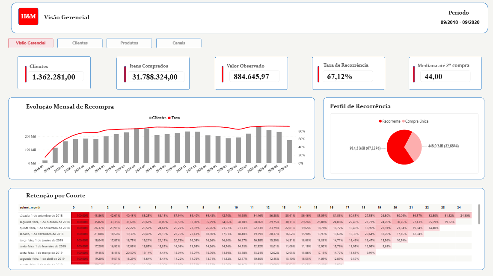
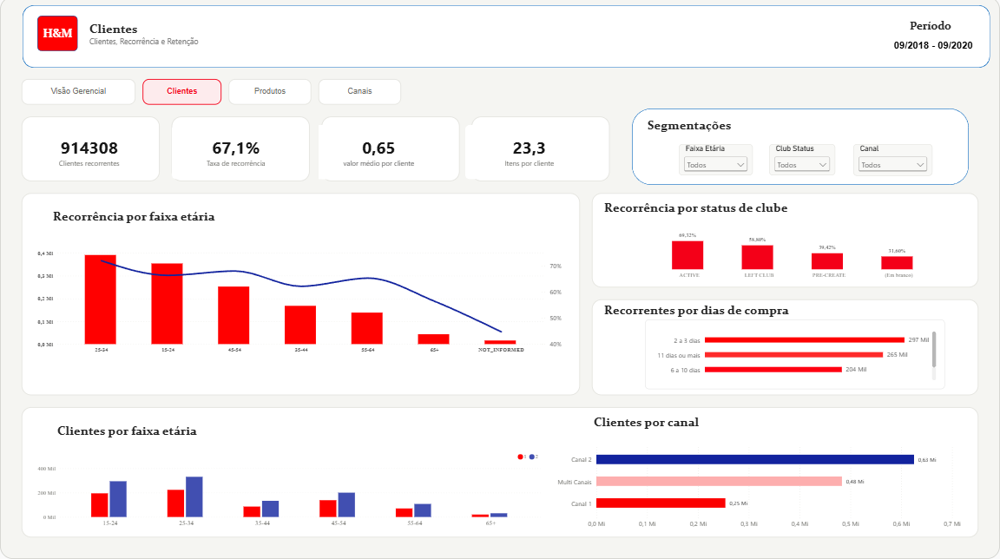
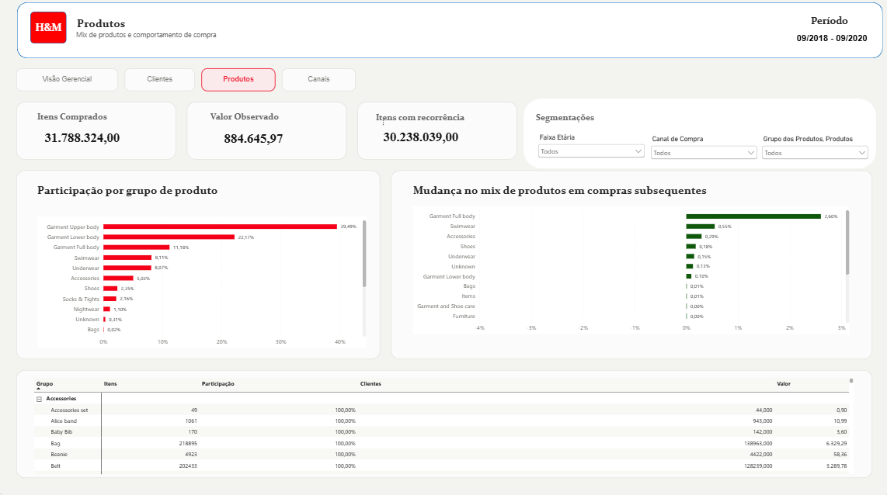
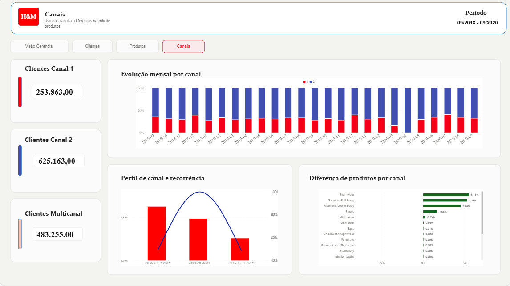

# **H&M Analytics**
 
 ---

# Resumo
--- 
## Sobre o projeto
 
Este projeto aplica Customer e Product Analytics aos dados transacionais da H&M, buscando entender a recorrência dos clientes e sua relação com as características dos consumidores, os grupos de produtos e os canais comerciais. O objetivo é identificar quais combinações de clientes, produtos e canais devem ser priorizadas em ações de CRM e em decisões de produto.
 
## Perguntas do projeto
 
A análise é orientada pelas seguintes perguntas:
 
- Qual é o nível de recorrência dos clientes e como ele evolui no período observado?
- Quanto os clientes recorrentes representam do volume de itens e do "valor" transacionado?
- Quais características e coortes de primeira compra apresentam maior recorrência, frequência e valor?
- Quais grupos de produtos estão associados à primeira compra e às compras posteriores?
- Como os canais comerciais se relacionam com recorrência, frequência, valor e preferência?

## Principais Conclusões


1. Recorrência dos clientes: 67,1% dos clientes compraram em pelo menos dois dias distintos. Entre os recorrentes, metade voltou em até 44 dias, embora os 50% centrais tenham retornado entre 13 e 120 dias.

2. Participação dos recorrentes: os clientes recorrentes concentraram 95,1% dos itens e 95,2% do valor observado. Eles compraram, em média, 33 itens, aproximadamente dez vezes a média dos clientes de compra única.

3. Características dos clientes: a faixa de 25 a 34 anos apresentou a maior recorrência, com 72%, enquanto membros ativos do clube e clientes multicanal também registraram maior frequência e valor observado. A retenção apresentou sua maior queda nos primeiros meses após a entrada.

4. Comportamento dos produtos: o grupo de produtos mudou pouco após a primeira compra observada. Garment Upper body caiu de 42,4% para 38,9%, enquanto Garment Full body aumentou de 9% para 11,6%, sendo os grupos de maior participação nas compras

5. Canais comerciais: os clientes exclusivos dos canais 1 e 2 apresentaram recorrência semelhante, mas o canal 2 registrou maiores médias de itens e valor. Os clientes multicanal apresentaram os maiores indicadores e também foram encontradas diferenças no mix de produtos entre os canais.

## Dashboard

### Visão Geral

- Apresenta os principais indicadores de clientes, itens, valor observado e recorrência, além da evolução mensal da recompra e da retenção por coorte.



### Clientes

- Compara recorrência, frequência e valor entre faixas etárias, status do clube e perfis de canal.



### Produtos

- Apresenta a participação dos grupos de produtos e as mudanças encontradas entre a primeira compra observada e as compras posteriores.



### Canais

- Compara clientes, recorrência, evolução mensal e diferenças no mix de produtos entre os canais comerciais.


--- 

# Etapas do Projeto

## Fonte dos dados
 
Os dados são provenientes da competição [H&M Personalized Fashion Recommendations](https://www.kaggle.com/competitions/h-and-m-personalized-fashion-recommendations/data), disponibilizada pela H&M no Kaggle.

Foram utilizadas três bases:

- `articles.csv`: atributos e classificações dos artigos;
- `customers.csv`: características cadastrais dos clientes;
- `transactions_train.csv`: histórico de itens comprados entre setembro de 2018 e setembro de 2020.
 

## Estrutura do Projeto

## Estrutura do projeto

```text
hm-analytics/
├── data/
├── notebooks/
├── powerbi/
│   ├── hm_analytics_projeto.Report/
│   ├── hm_analytics_projeto.SemanticModel/
│   ├── imagens/
│   └── hm_analytics_projeto.pbip
├── .env.example
├── .gitignore
├── README.md
└── requirements.txt
```

## Inspeção dos dados
 
Cada base foi avaliada quanto ao tamanho, aos tipos de coluna, à cardinalidade, aos valores ausentes, aos registros repetidos e aos relacionamentos entre as tabelas.
 
### Principais resultados:

- Todos os clientes e artigos presentes nas transações possuem correspondência em suas respectivas bases;
- Articles possui 105.542 registros;
- Customers possui 1.371.980 registros;
- Transactions possui 31.788.324 registros de itens comprados;
- As transações abrangem o período de setembro de 2018 a setembro de 2020;
- Em relação aos valores ausentes e duplicados: Articles não possui valores ausentes ou duplicados. As ausências encontradas nos dados dos clientes foram preservadas, e os registros repetidos de transactions foram mantidos, pois podem representar múltiplas unidades compradas.
 
## Limpeza e padronização
 
As principais transformações aplicadas foram:
 
- remoção de detail_desc, que não será utilizada na análise;
- remoção de postal_code, já que o conteúdo anonimizado não permite interpretação geográfica;
- conversão dos identificadores de artigos e produtos para texto;
- conversão dos códigos de classificação para variáveis categóricas;
- padronização de FN e Active em letras minúsculas;
- padronização de club_member_status e fashion_news_frequency em letras maiúsculas;
- conversão de age para inteiro anulável;
- conversão de t_dat para data;
- preservação dos valores ausentes, das categorias oficiais e dos registros repetidos.
- Preservação das linhas durante o processo.
 
## Validação das bases processadas
 
As três bases tratadas foram exportadas em Parquet e validadas por meio dos metadados:
 
| Arquivo | Linhas | Colunas | Tamanho aproximado |
|---|---|---|---|
| articles_clean.parquet | 105.542 | 24 | 2,91 MB |
| customers_clean.parquet | 1.371.980 | 6 | 80,64 MB |
| transactions_clean.parquet | 31.788.324 | 5 | 736,01 MB

## Feature engineering

Após a limpeza, foram criadas variáveis para analisar a recorrência dos clientes e sua relação com produtos e canais comerciais. Para atender às perguntas elaboradas no início do projeto, foram criadas features que trouxeram as seguintes informações:

1. datas da primeira, segunda e última compra observada;
2. quantidade de dias distintos com compra e total de itens adquiridos;
3. valor observado durante o período;
4. tempo até a segunda compra e recência da última compra;
5. tempo disponível para acompanhamento de cada cliente;
6. identificação de clientes recorrentes;
7. mês da primeira compra observada e índice de coorte;
8. quantidade de artigos distintos adquiridos;
9. quantidade de canais utilizados e classificação entre canal único e multicanal;
10. agrupamento dos clientes por faixa etária;
11. classificação das transações entre a primeira data de compra observada e as datas posteriores.
12. Foram geradas três tabelas analíticas:
13. customer_purchase: histórico consolidado e características de cada cliente;
14. customer_monthly: comportamento mensal dos clientes e acompanhamento das coortes;
15. transactions_features: transações enriquecidas com o mês e o estágio da compra.

Com isso foram geradas 3 tabelas analíticas principais que foram exportadas em Parquet e serão utilizadas para a etapa de análise exploratória.

## Análise Exploratória,
A análise exploratória foi orientada pelas perguntas definidas no início do projet,o, com foco na recorrência e em sua relação com clientes, produtos e canais.

### Principais resultados

- 67,1% dos clientes realizaram compras em pelo menos dois dias distintos;

- os recorrentes concentraram 95,1% dos itens e 95,2% do valor observado;

- metade dos clientes recorrentes realizou a segunda compra em até 44 dias;

- a retenção apresentou maior queda nos primeiros meses após a entrada;

- a faixa de 25 a 34 anos e os membros ativos do clube apresentaram os maiores indicadores de recorrência;

- o mix de produtos mudou pouco entre a primeira compra observada e as posteriores;

- as maiores diferenças no mix de produtos foram encontradas entre os canais comerciais.

- As relações identificadas são descritivas e não devem ser interpretadas como causais.

## Visualização de Dados

### Dashboard no Power BI

O dashboard foi desenvolvido em PowerBI contendo quatro páginas:

1. Visão Gerencial;
2. Clientes;
3. Produtos;
4. Canais Comerciais.

As páginas trazem algumas das métricas analisadas na EDA com o objetivo de responder de forma visual as perguntas iniciais do projeto.


### Limitações

- Price é uma variável normalizada, o que dificulta tirar conclusões acerca do valor real gasto pelos clientes;
- Os registros representam itens, não pedidos, pois a base não possui os identificadores de pedidos;
- Os meses de setembro de 2018 e setembro de 2020 não representam meses completos.
